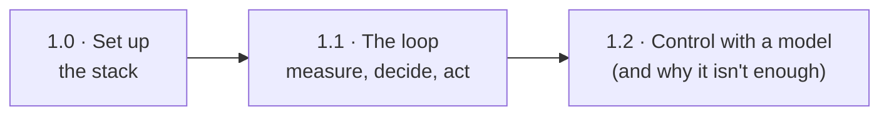
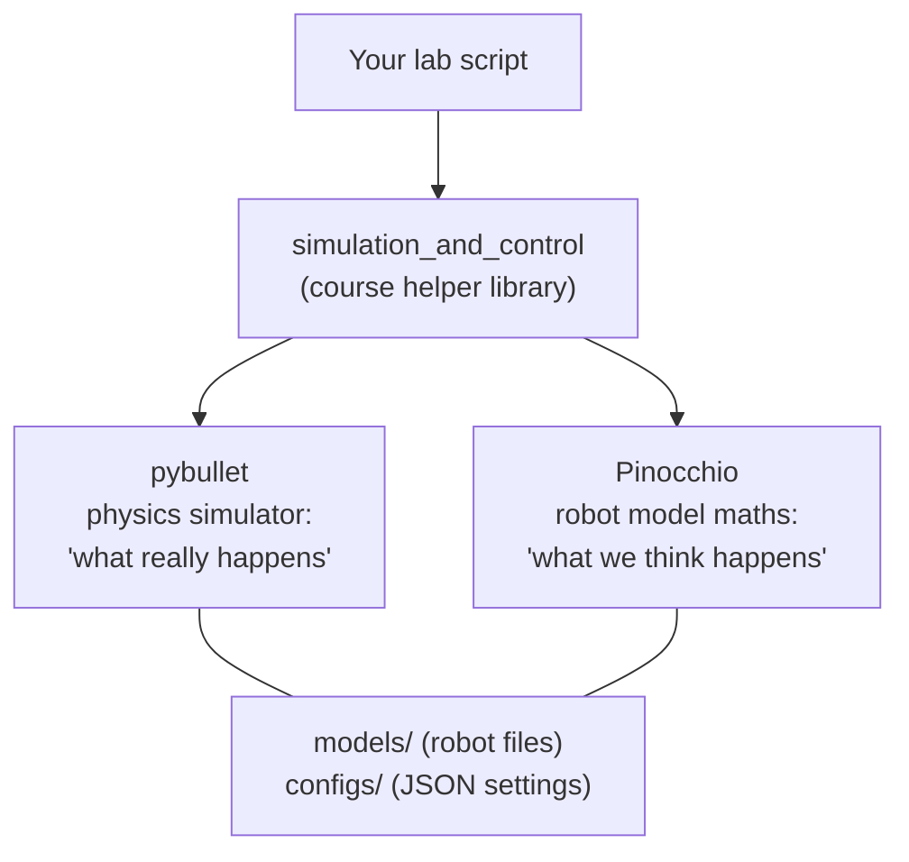
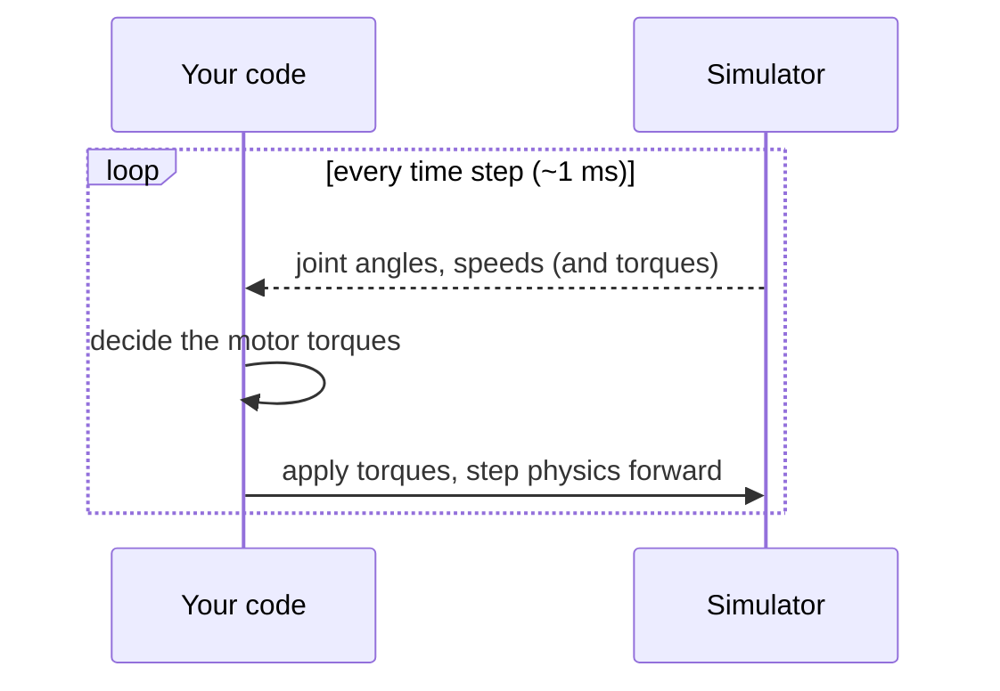
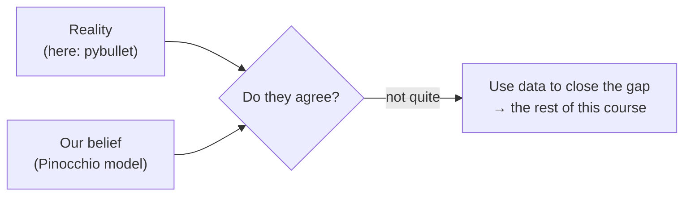
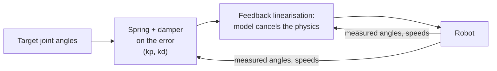
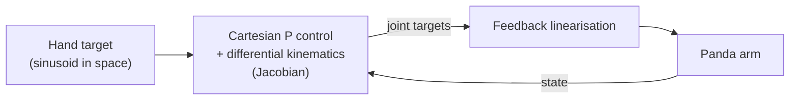

# Chapter 1 · Workbench: the robot in the computer

Before a robot can learn anything, you need somewhere safe to run it and a way to
record what it does. This chapter sets up that workbench: a physics simulator, a robot
model, and the classic model-based controllers that the rest of the course tries to
improve on with data.

---

## 1.0 · Set up the stack

*What actually happens when you run one of the lab scripts?*

Your script talks to a helper library, which drives two different engines: one that
*simulates* the robot and one that *calculates* with a model of it.

**In this repo:** each week's `configs/` and `models/` folders come from your RoboEnv
checkout, not from Git (see the weekly READMEs). Press **`q` in the pybullet window**
to stop a script; Ctrl+C can leave the window running. The final task also reads
`ROBOENV_HEADLESS` and `ROBOENV_MAX_STEPS`, which are handy for collecting data without
a GUI.

**Look up:** *pixi*, *RoboEnv*, *pybullet quickstart*, *Pinocchio*, *URDF*. Run
`pixi run smoke-test` first.

---

## 1.1 · The loop: measure, decide, act

*How does a simulated robot move at all?*

Every script here is the same loop, about a thousand times per simulated second:

`induction_simulator.py` sends **zero torque**, so the arm simply falls under gravity.
Watching that is the first lesson: holding still takes effort.

It also prints the robot's masses and inertias **twice**: once from the simulator and
once from Pinocchio. That pair is the seed of the whole course.

On a real robot, "reality" is the hardware, and the gap is always bigger.

**Look up:** *control loop*, *time step*, *torque control*, *joint state*.

---

## 1.2 · Control with a model, and why it isn't enough

*If you know the physics perfectly, how do you make the arm follow a path?*

**Feedback linearisation** (also called *computed torque*) uses the model to cancel the
robot's physics: gravity, inertia, the whirling effects. What's left behaves like a
simple spring and damper pulling towards the target.

To steer the **hand** instead of the joints, `cartesian_kinematic_controller.py` adds a
layer on top. The Jacobian turns "move the hand this way" into joint speeds:

The headline: **these controllers are only as good as the model inside them.** Get the
masses wrong and the "cancellation" leaves errors behind. Chapters 2–4 attack exactly
that.

**In this repo:** 🧩 The Cartesian script sets `kp_ori = 0`. What does that mean for the
hand's orientation? 🧩 Make Pinocchio's link masses 20% wrong. How much worse does
tracking get, and in which joints?

**Look up:** *feedback linearisation / computed-torque control*, *differential inverse
kinematics*, *Jacobian*, *PD control*. Read *Modern Robotics* Ch. 8 (dynamics) and
Ch. 11 (control).

**🛠 Prove it:** Build a **data-collection harness** you'll reuse in every chapter. It
takes any controller and any reference, records joint angles, speeds, accelerations and
both commanded and measured torques to a tidy file with metadata, and replays
deterministically. *Passed when* two runs with the same settings produce identical
files, and you've measured how noisy and how delayed the simulator's acceleration
estimate is compared with smoothing it yourself.

---

**The story so far:** we can simulate, control and record a robot, and we've seen that
model-based control is limited by the model. Next: can data tell us the model's missing
numbers?

Next → [Chapter 2 · Fit the physics](2-fit-the-physics.md)
