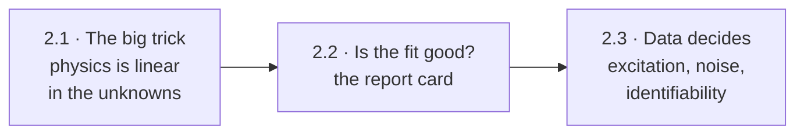
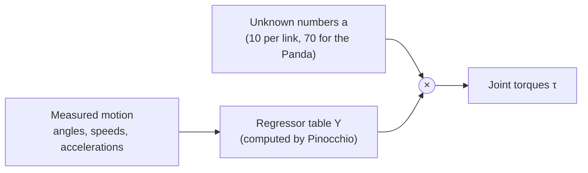
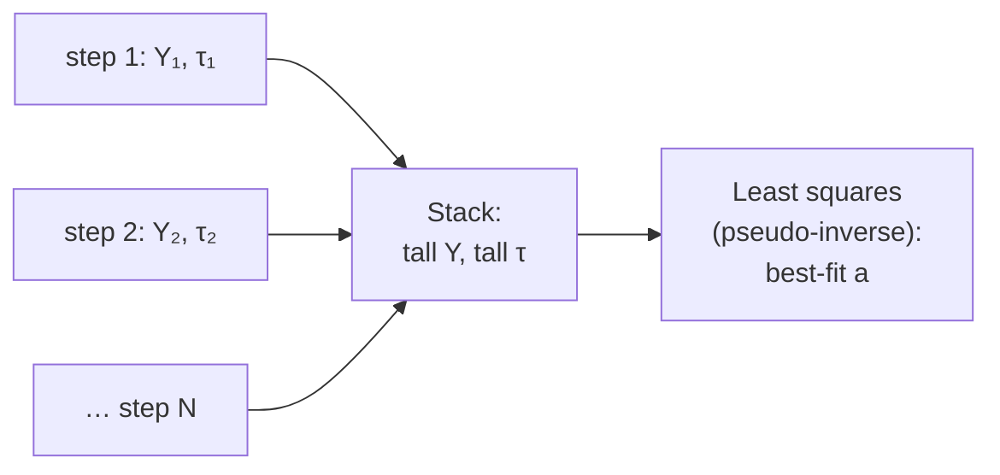
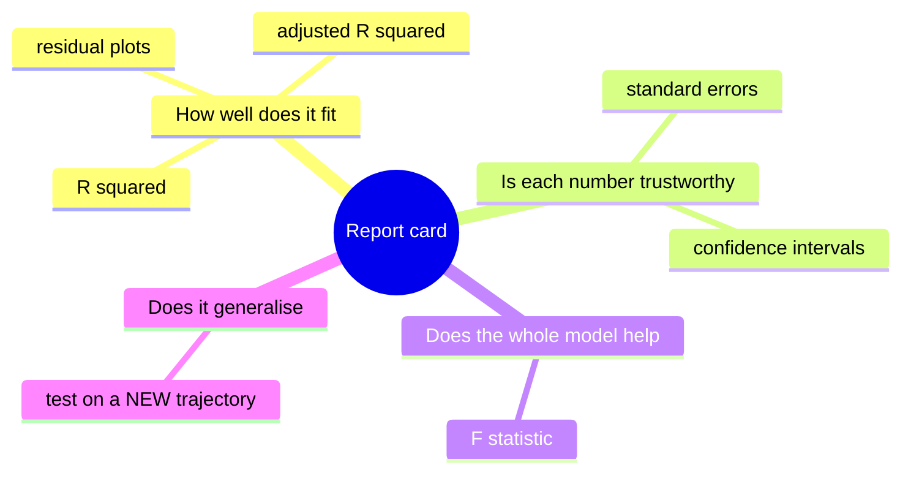
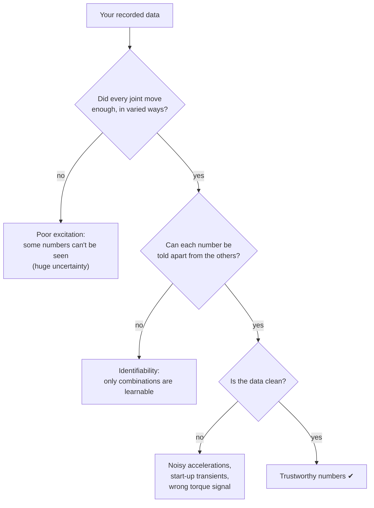

# Chapter 2 · Fit the physics: learn the robot's hidden numbers

The model-based controllers from Chapter 1 need each link's mass, centre of mass and
inertia. Manufacturers' numbers are approximate, and a gripper or payload changes them.
Can we *measure* them by watching the robot move? Yes, thanks to one beautiful fact
about robot physics.

---

## 2.1 · The big trick: linear in the unknowns

*The arm's equations are horribly nonlinear in its angles. How can a straight-line fit
possibly work?*

Because the nonlinearity is all in the **motion**, which you measure. The **unknown
numbers** (10 per link: mass, mass × centre-of-mass position, and 6 inertia values)
only ever appear *multiplied* by things computed from the motion. So:

One time step gives 7 equations (one per joint) in 70 unknowns: hopeless on its own.
But a 10-second run gives ~10,000 time steps, so you **stack** them all into one very
tall system and find the numbers that fit best overall:

That's ordinary linear regression: the same idea as fitting a line through a scatter
plot, in 70 dimensions.

**In this repo:** `week1/dynamic_regression.py` collects the data and leaves the
stacking and fitting as TODOs. The README warns you about a stray `s` on line 91 that
crashes the script. `week2/dynamic_regression_nonlinear.py` shows Pinocchio's own
"true" numbers (`a_GT`) to check yourself against.

**Look up:** *linear in the dynamic parameters*, *dynamic regressor*, *least squares*,
*Moore–Penrose pseudo-inverse*, *normal equations*. Read Siciliano et al., Ch. 7
(dynamic parameter identification) and ISL Ch. 3 (linear regression).

---

## 2.2 · Is the fit any good? The report card

*You have 70 numbers. Should you trust them?*

Headlines:
* **Plot the residuals over time.** Patterns, not just their size, reveal what the
  model is missing (friction shows up as a step whenever a joint reverses).
* **Adjusted R² penalises extra unknowns.** Adding parameters always improves plain R²,
  even useless ones.
* **The only honest test is unseen data.** Fit on one trajectory, judge on a different
  one.

**Look up:** *coefficient of determination*, *adjusted R²*, *F-test*, *confidence
intervals for regression coefficients*, *residual analysis*, *statsmodels OLS*. Read
ISL Ch. 3.

---

## 2.3 · The data decides everything

*Why can the same code give perfect numbers on one run and nonsense on another?*

Three headlines:
* **Excitation.** You can't learn a joint's inertia if it never accelerates. Good
  trajectories shake every joint at several speeds. The *condition number* of the
  stacked table measures how well you did.
* **Identifiability.** Some numbers never affect any torque. Link 1 only spins about a
  vertical axis, so most of its 10 numbers are invisible. Others only appear in fixed
  combinations. Only those combinations, the **base parameters**, can be learned. That's
  why isolating the *last* joint is a gentle first exercise.
* **Accelerations are estimated, not measured.** The simulator differences velocities,
  which is noisy and a step late. Noise in the inputs biases least squares.

**In this repo:** 🧩 Week 2 throws away the first 100 time steps (`fit_start`), and the
code asks you why. 🧩 Week 1 records *measured* torque while week 2 regresses on
*commanded* torque. When do those differ, and which should you trust?

**Look up:** *excitation trajectory design*, *condition number*, *base parameters*,
*errors-in-variables*, *physically consistent inertia*. Read Swevers et al., "Optimal
Robot Excitation and Identification" (IEEE TRA 1997) and Gaz et al.'s identification of
the Franka Panda (RA-L 2019).

**🛠 Prove it** (after the Week 1–2 lab): Identify the **whole** Panda using your own
excitation trajectories, designed to minimise the condition number. *Passed when* torque
predictions on a trajectory you never trained on reach R² > 0.99 for most joints, you
report confidence intervals, and you show a plot of how condition number drives
parameter error.

---

**The story so far:** if the physics formula is right, data recovers its numbers
beautifully. But real robots have friction, flexible gears and cables that the formula
leaves out. Next: learning what the formula is missing.

Next → [Chapter 3 · Beyond the formula](3-beyond-the-formula.md)
