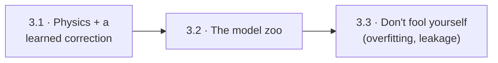
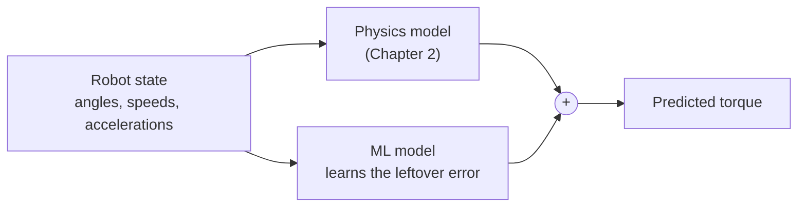
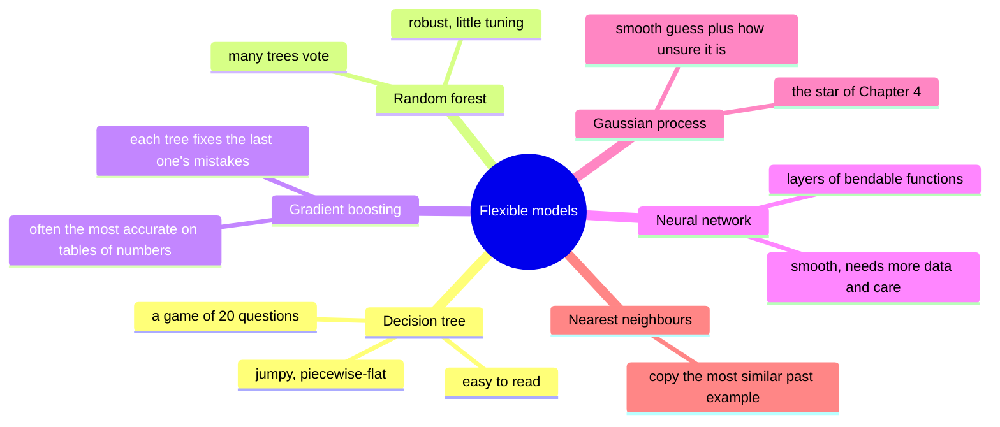
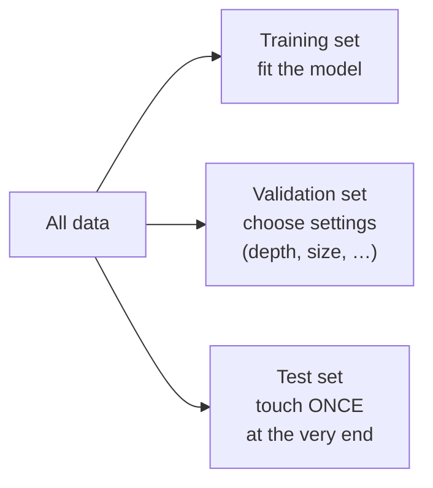
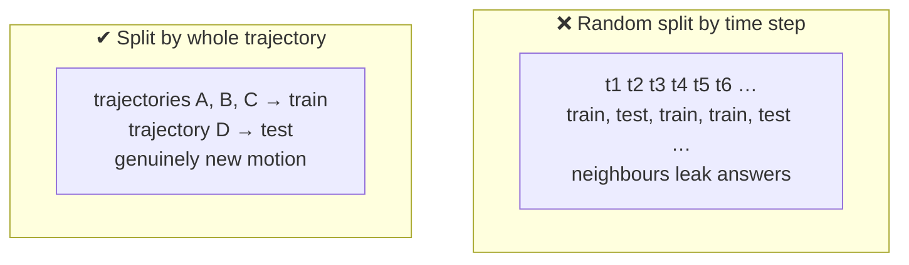

# Chapter 3 · Beyond the formula: learn what physics leaves out

Chapter 2 worked because we knew the *shape* of the equation and only lacked its
numbers. Real robots also have friction that sticks and slips, gears that flex, cables
that pull, and motors that heat up. None of that is in the textbook formula. This
chapter is about learning functions whose shape you *don't* know, without fooling
yourself.



---

## 3.1 · Physics plus a learned correction

*Should you throw the physics away and let a network learn everything?*

Usually not. Keep what you know and learn only what's missing, the **residual**:



This **grey-box** approach needs far less data than learning from scratch. It also
degrades gracefully: far from the training data, the correction fades and the physics
still holds.

**Look up:** *residual learning*, *grey-box modelling*, *model learning for robot
control*. Read Nguyen-Tuong & Peters, "Model Learning for Robot Control: A Survey"
(Cognitive Processing, 2011).

---

## 3.2 · The model zoo

*Which flexible model should fill the gap?*



The headline: **trees can't extrapolate.** A tree's prediction is an average of training
examples, so beyond the data it goes flat. A physics model, or even a straight line,
keeps the trend going.

```text
 torque │              ●  ●              true trend continues ↗
        │          ●  ●     ┌─────────── tree goes flat beyond the data
        │      ●  ●  ┌──────┘
        │  ●  ●  ┌───┘
        │ ┌──────┘
        └───────────────────────────── speed
           ← training data →│← new territory
```

**In this repo:** `week2/dynamic_regression_nonlinear.py` fits the last joint with
physics, then leaves a decision tree as a TODO, with the plots ready to compare the two.

**Look up:** *decision tree regression*, *random forest*, *gradient boosting (XGBoost,
LightGBM)*, *multilayer perceptron*, *k-nearest neighbours*, *feature engineering*. Read
ISL Ch. 8 (trees) and Ch. 10 (deep learning), and watch StatQuest's videos on trees and
boosting.

---

## 3.3 · Don't fool yourself

*Your model scores 99.9% on your data. Why might it still be useless?*

Flexible models can memorise noise. The trade-off looks like this:

```text
   underfit (too simple)        just right               overfit (memorises noise)
   ──────────────────           ╭─╮   ╭─╮                ╭╮╭─╮ ╭╮╭╮
         ● ●  ●  ●            ●╯ ● ╰●╯ ● ╰●            ●╯╰╯● ╰─╯╰╯●
   misses the pattern         follows the pattern      follows every wiggle
```

Choose model complexity using data the model didn't train on:



The robotics-specific trap is **leakage**. Robot data is a time series, and neighbouring
time steps are nearly identical. Split randomly by time step and the "test" set is just
the training set with tiny shifts, so scores look great and mean nothing.



**Look up:** *bias–variance trade-off*, *cross-validation*, *time-series split / data
leakage*, *regularisation*, *learning curves*, *hyperparameter tuning*. Read ISL Ch. 5
(resampling) and Ch. 6 (regularisation).

**🛠 Prove it** (after the Week 2 lab): A model bake-off for joint torques. Pit physics-only,
a decision tree, a random forest, boosting, an MLP, and physics + learned residual
against each other. Give the simulated robot unmodelled friction so there's something
to learn. *Passed when* you produce leakage-free results (split by trajectory), learning
curves (error vs amount of data), and a demonstration of which models fall apart on a
faster trajectory than any they trained on, with an explanation of why.

---

**The story so far:** we can learn a robot's physics, with or without a complete
formula, and test it honestly. Every model so far had plenty of data. Next: what if each
data point costs a whole experiment?

Next → [Chapter 4 · Learn to tune](4-learn-to-tune.md)
