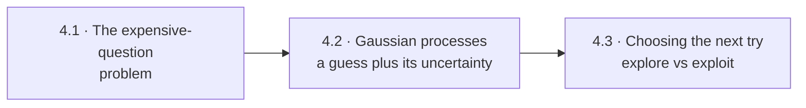
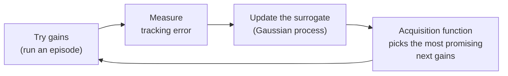
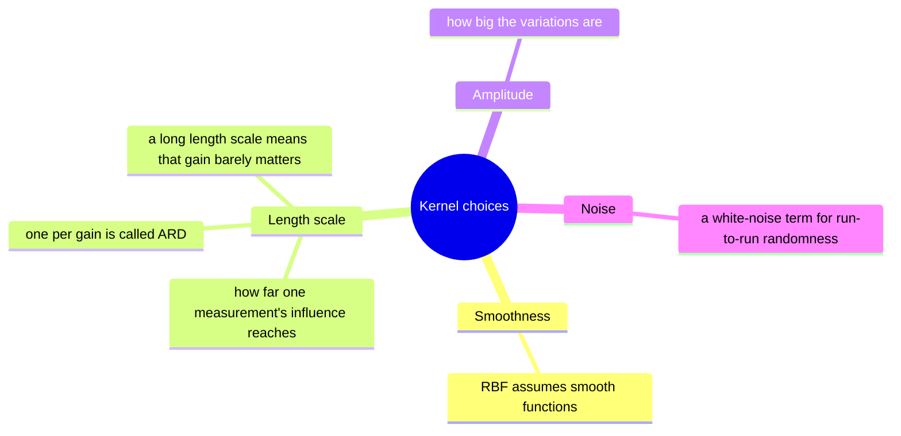
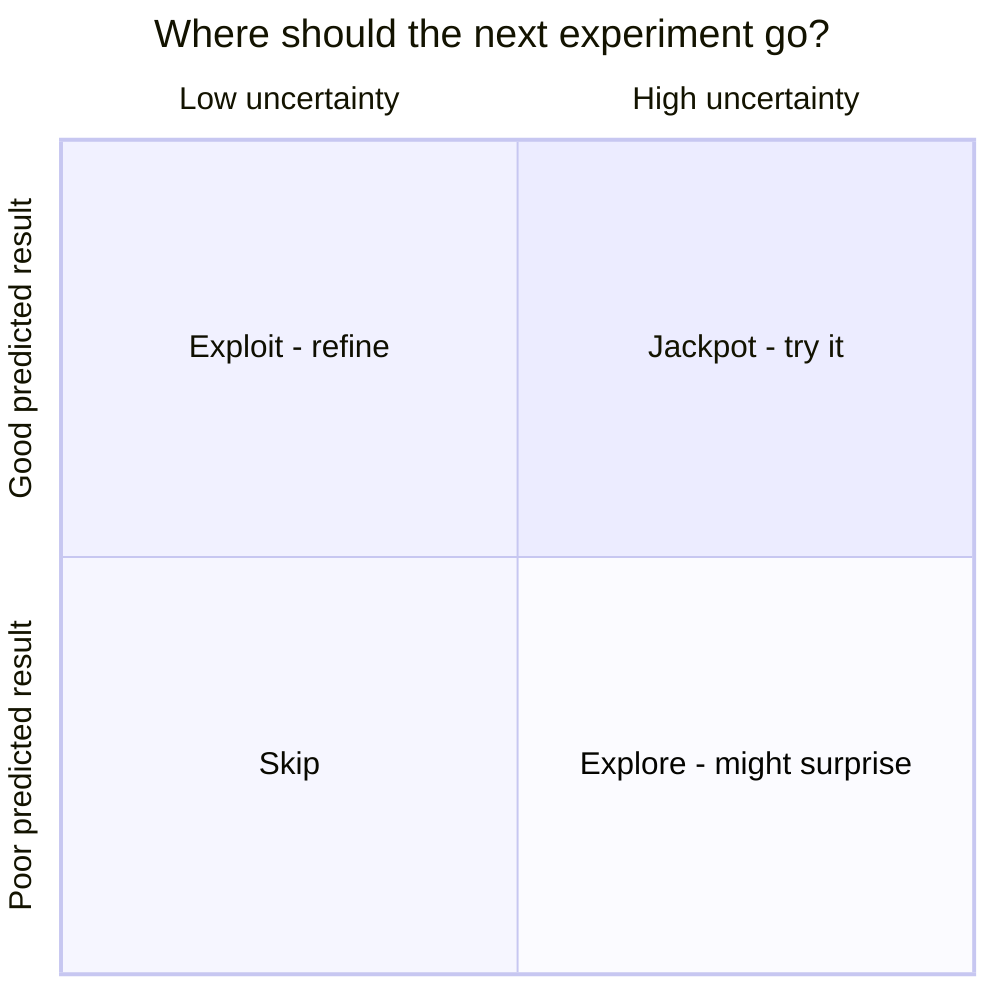

# Chapter 4 · Learn to tune: find the best settings in few tries

A controller has knobs (gains). Turn them wrong and the arm wobbles or lags; turn them
right and it tracks beautifully. With 14 knobs (stiffness and damping for 7 joints),
and each test taking a whole episode, you can't try everything. You need a strategy
that learns *where to look next*. That strategy is **Bayesian optimisation**, and its
engine is the **Gaussian process**.



---

## 4.1 · The expensive-question problem

*If each experiment costs minutes (or wears out a real robot), how do you search a
14-dimensional space?*

Grid search needs millions of tries and random search wastes them. Bayesian optimisation
builds a cheap **stand-in model** (a *surrogate*) of "gains → tracking error" from the
tries so far, then uses it to pick the most promising next try:



It starts with some random tries to get a rough picture, then becomes increasingly
clever about where to spend each new experiment.

**In this repo:** `week3/BO_for_pid_tuning.py` wraps a whole simulated episode as one
"expensive function call" and hands it to scikit-optimize's `gp_minimize`.

**Look up:** *black-box optimisation*, *surrogate model*, *Bayesian optimisation*,
*scikit-optimize gp_minimize*. Read Frazier, "A Tutorial on Bayesian Optimization"
([arXiv:1807.02811](https://arxiv.org/abs/1807.02811)).

---

## 4.2 · Gaussian processes: a guess plus its uncertainty

*What's special about the surrogate?*

A **Gaussian process (GP)** doesn't give one curve. It gives a whole *cloud* of plausible
curves: a best guess, plus a band showing how unsure it is. The band pinches tight near
points you've measured and widens in the unknown.

```text
 error │  ░░░░░                                  ░░░░░░░░
       │ ░░░░░░░░       ░░░            ░░░      ░░░░░░░░░░   ░ = uncertainty band
       │░░─────░░●─────●───●──────────●───●───░░────────░░   ─ = best guess
       │ ░░░░░░░         ░░░            ░░░      ░░░░░░░░░░   ● = experiments so far
       │  ░░░░                                    ░░░░░░░░
       └──────────────────────────────────────────────────── gain
          unsure        sure near data          very unsure
```

Its assumptions live in the **kernel**:



The kernel's settings are themselves learned from the data by maximising the
*marginal likelihood*, which is how well the GP explains what it has seen.

**In this repo:** `week3/gp_functions.py` builds an amplitude × per-gain RBF kernel, with
an optional white-noise term (`USE_WHITE_KERNEL`), on gains rescaled to [0, 1].
🧩 Why rescale before fitting? What would one shared length scale do with gains ranging
0–1000 and 0–100? 🧩 After a run, read the learned length scales. Which gains does the
GP think matter?

**Look up:** *Gaussian process regression*, *RBF / squared-exponential kernel*,
*automatic relevance determination*, *marginal likelihood*, *posterior variance*. Play
with Distill's
[visual exploration of GPs](https://distill.pub/2019/visual-exploration-gaussian-processes/),
then read Rasmussen & Williams Ch. 2 and 5.

---

## 4.3 · Choosing the next try: explore vs exploit

*Should the next experiment go where the guess is best, or where you know least?*

Both matter. The **acquisition function** scores every candidate by balancing them:



| Acquisition | In plain words |
|---|---|
| Probability of improvement | "How likely is this to beat my best so far?" |
| Expected improvement | "…and by how much, on average?" (the lab's default) |
| Lower confidence bound | "Be optimistic: assume the best plausible outcome" |

Headlines:
* **The optimiser serves the objective, not you.** If the cost only measures
  tracking error, BO will happily pick enormous gains that track well but would shake a
  real robot apart. Add what you care about (torque, smoothness) to the cost.
* **Safety matters on hardware.** Safe BO only tries gains that the GP is confident won't
  go unstable.
* **BO shines below ~20 knobs.** Beyond that, the surrogate struggles.

**In this repo:** 🧩 The Week 3 README promises 10 episodes of 10 s, but the code runs
50 calls (25 random to start) with 5-second episodes. Trust the code, and ask why the
numbers changed. 🧩 What does the objective ignore that a real robot would care about?

**Look up:** *expected improvement*, *upper/lower confidence bound*, *exploration vs
exploitation*, *safe Bayesian optimisation (SafeOpt)*, *high-dimensional BO*. Read
Garnett's [*Bayesian Optimization*](https://bayesoptbook.com/) (free), and Berkenkamp et
al., "Safe Controller Optimization for Quadrotors with Gaussian Processes" (ICRA 2016).

**🛠 Prove it** (after the Week 3 lab): Write GP regression yourself (Cholesky
factorisation, marginal-likelihood fitting) and your own BO loop with two acquisition
functions. Then add a torque penalty and a safety rule. *Passed when* your GP matches
scikit-learn's predictions to 1e-6 with the same settings, your BO matches
scikit-optimize's final tracking error (averaged over 10 random seeds) in the same
number of tries, and the safe version never runs an episode that goes unstable.

---

**The story so far:** we can learn physics, learn corrections and learn the best gains
for a controller someone else designed. Next: learning the controller itself.

Next → [Chapter 5 · Learn to act](5-learn-to-act.md)
