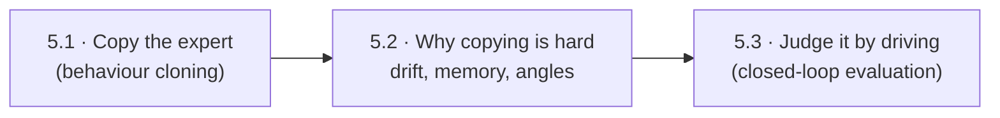
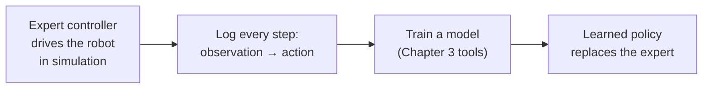
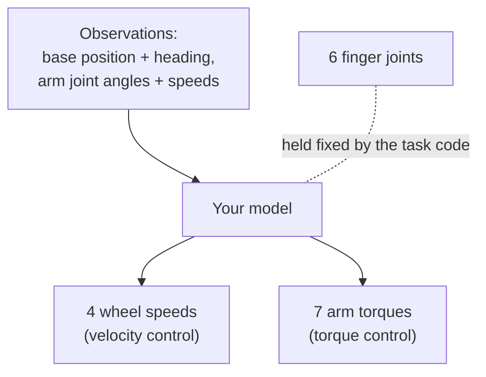
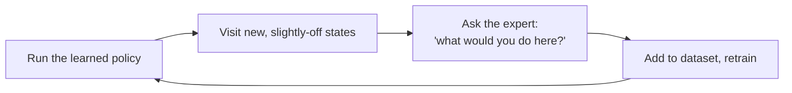
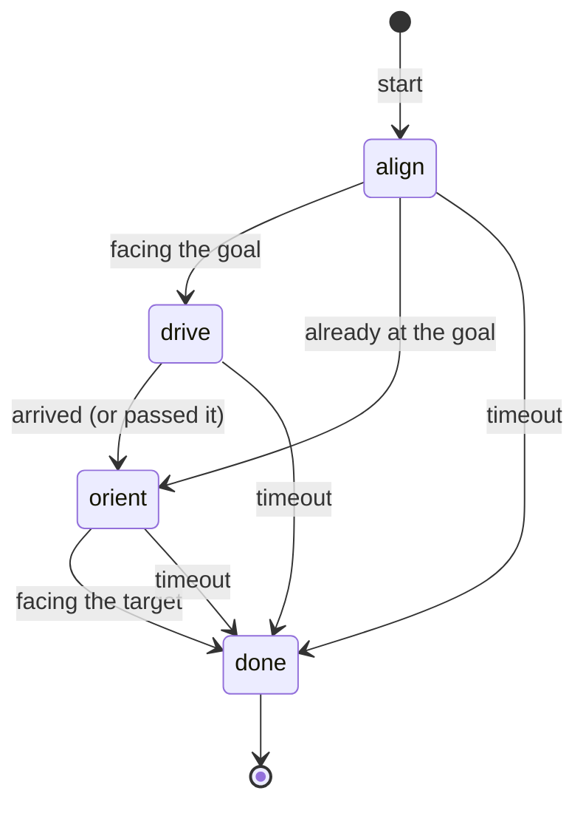
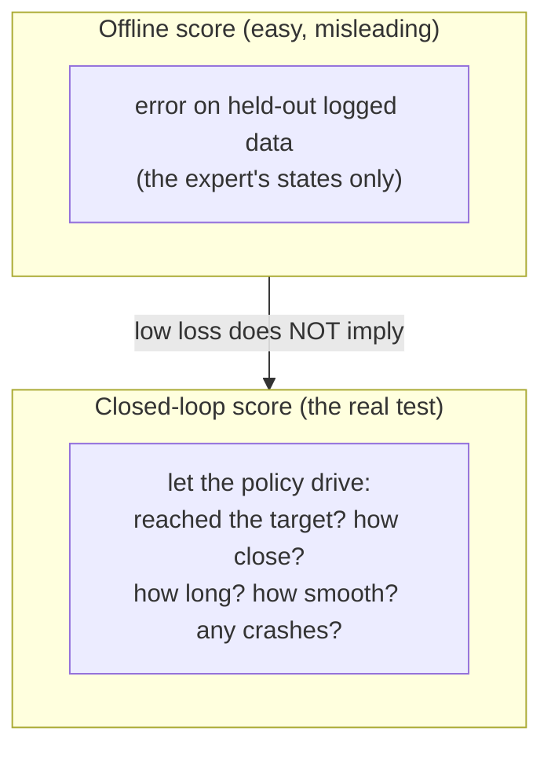

# Chapter 5 · Learn to act: copy an expert controller

So far, learning has *helped* hand-written controllers. Now we replace one. The final task
gives you a working expert: a hand-tuned controller that drives a four-wheeled base up to
a target and reaches it with a 7-joint arm. Your job is to train a model that does the
same from measurements alone. This is **imitation learning**, and it has traps that
ordinary regression doesn't.



> The final task is assessed, so this chapter explains the ideas and the traps. It
> deliberately doesn't tell you which model, inputs or tricks to use.

---

## 5.1 · Copy the expert

*If you can record an expert's every move, isn't learning to act just regression?*

At first glance, yes. A **policy** maps what the robot senses (observations) to what it
does (actions). Record the expert, then fit a model:



In the final task the robot has two halves with different kinds of command:



**In this repo:** `final/robotnik_arm_task/robotnik_arm_control.py` is the expert. Its
base controller is a little state machine, and its arm controller is damped
differential IK with joint limits, plus PD and gravity compensation. `ROBOENV_HEADLESS=1`
and `ROBOENV_MAX_STEPS` let you run it without a window, which is how you'd collect
data at scale.

**Look up:** *behaviour cloning*, *policy*, *observation vs state*, *imitation
learning*. Read Osa et al., "An Algorithmic Perspective on Imitation Learning"
([arXiv:1811.06711](https://arxiv.org/abs/1811.06711)), Ch. 1–3.

---

## 5.2 · Why copying is hard

*The model's test loss is tiny. Why does the robot still wander off?*

**Trap 1: drift.** The model makes a small mistake and lands somewhere the expert never
went. There it has no examples, so it makes a bigger mistake, and so on. Errors snowball.

```text
  expert path:   ●───●───●───●───●───●───● 🎯
  your policy:   ●───●───●──╮
                             ╰──●
                                 ╰───●       ← each step a little further from
                                       ╰──●     anything it was trained on
```

The classic fix lets the expert *correct the learner on the learner's own mistakes*:



**Trap 2: hidden memory.** A model that sees only the current measurements can only copy
an expert whose decisions depend on those measurements alone. Look at the expert's base
controller:



The same position can need different wheel commands depending on which *phase* the
expert is in. The arm controller also carries a running joint reference from step to
step. 🧩 Which parts of the expert's internal memory can be inferred from the measurements
the task lists, and which can't? What does that mean for your model?

**Trap 3: the inputs themselves.** Some quantities need care before a model sees them:
* **Angles wrap around.** A heading of +179° and −179° are almost the same direction but
  look far apart as numbers.
* **Scales differ wildly** (metres, radians, rad/s), so most models need normalised inputs.
* 🧩 **The target isn't in the task's input list.** What does that imply if you want the
  robot to reach a target it wasn't trained on?

**Look up:** *compounding error / covariate shift*, *DAgger*, *non-Markovian expert*,
*history / recurrent policies*, *feature normalisation*, *angle wrapping (sin/cos
encoding)*. Read Ross, Gordon & Bagnell's DAgger paper (AISTATS 2011).

---

## 5.3 · Judge it by driving

*How do you know your policy is good?*

There are two very different scores, and only one of them is the real exam:



Test across many targets, start poses and random seeds, and report success rates with
error bars, not one lucky video.

**Look up:** *closed-loop evaluation*, *success rate*, *confidence intervals*,
*generalisation to new goals*.

**🛠 Prove it:** Practise on something that **isn't** assessed: Week 1's Panda Cartesian
controller. Clone it with a neural network, measure the drift, add DAgger, and compare
closed-loop tracking. *Passed when* you can show an offline score that looks great next to
a closed-loop failure, and then fix it with DAgger, with plots. Then apply what you
learned to the final task on your own.

---

**The story so far:** we've gone from learning numbers, to learning corrections, to
learning gains, to learning a whole controller from an expert. What if there's no expert
at all?

Next → [Chapter 6 · Where next](6-where-next.md)
