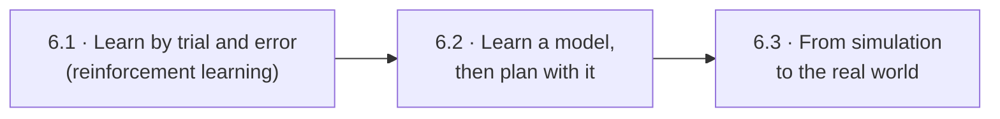
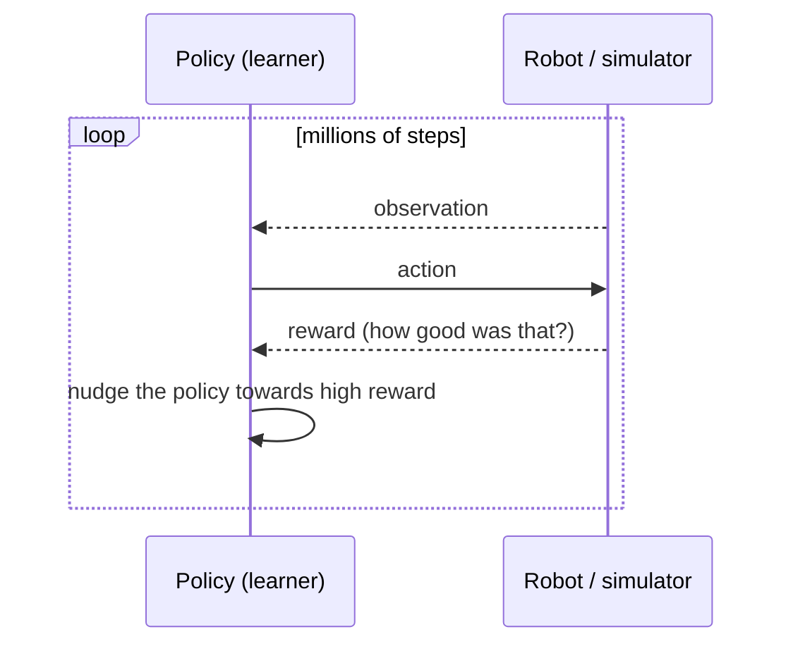
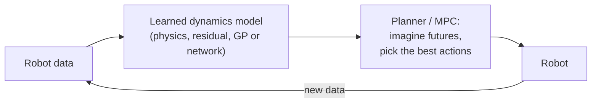
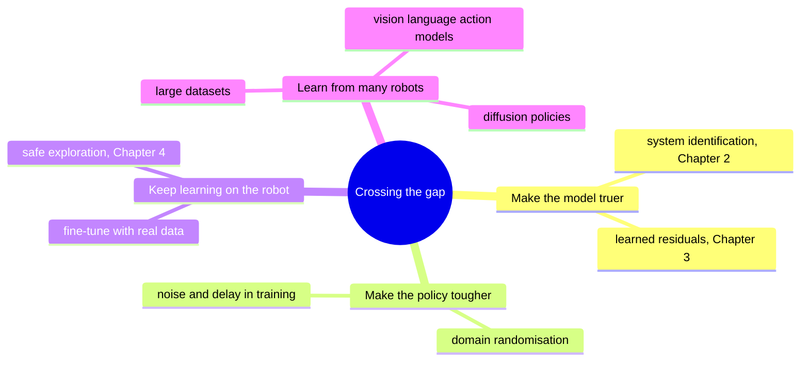

# Chapter 6 · Where next: trial and error, and crossing to reality

Every chapter so far needed something to learn *from*: a physics formula, logged data, or
an expert to copy. The frontier of robot learning removes those crutches, and then has
to survive contact with real hardware. This chapter is a map of that frontier, not a
manual.

---

## 6.1 · Learn by trial and error

*No expert, no formula, just a score. Can a robot teach itself?*

**Reinforcement learning (RL)** tries actions, receives rewards, and slowly favours what
worked:

Headlines:
* **Hungry for data.** Millions of steps is normal, which is why RL lives in simulators
  running thousands of copies in parallel.
* **Reward hacking.** Like the BO objective in Chapter 4, RL exploits any loophole in the
  reward.
* **You can start from a good controller.** *Residual RL* learns only a correction on top
  of a classical controller, which is safer and much faster.

**Look up:** *Markov decision process*, *policy gradient / PPO*, *SAC*, *reward shaping*,
*residual reinforcement learning*. Read Sutton & Barto (free) and OpenAI's
[Spinning Up](https://spinningup.openai.com/); watch Berkeley's
[CS 285](https://rail.eecs.berkeley.edu/deeprlcourse/).

---

## 6.2 · Learn a model, then plan with it

*What if you combine Chapter 2's lesson (learn the physics) with Chapter 4's (plan
cleverly)?*

This **model-based** route needs far less real-world data than pure RL, and a GP model
even knows where it's unsure. That idea powers PILCO, which learned to swing up a
cart-pole in a handful of trials.

**Look up:** *model-based RL*, *model predictive control with learned models*, *PILCO*,
*probabilistic ensembles (PETS)*. Read Deisenroth & Rasmussen, "PILCO" (ICML 2011).

---

## 6.3 · From simulation to the real world

*Everything in this course ran in pybullet. Will it work on a real robot?*

Not automatically. That's the **sim-to-real gap**: real friction, delays, sensor noise
and wear differ from the simulator.

**Look up:** *sim-to-real*, *domain randomisation*, *diffusion policy*,
*vision-language-action models*, *LeRobot*. Read Tobin et al., "Domain Randomization"
(IROS 2017) and Chi et al., "Diffusion Policy" (RSS 2023).

**🛠 Prove it:** One task, four learners. Pick a Panda reaching task and solve it with (a) BO-tuned
PD gains, (b) behaviour cloning of the Cartesian controller, (c) PPO from scratch and
(d) residual RL on top of the PD controller. *Passed when* you plot success against
**number of simulated episodes used** for all four, averaged over several seeds, and can
explain the ranking.

---

**The end of the story.** You've climbed from fitting a handful of physical numbers, to
learning what physics leaves out, to tuning controllers with a principled guesser, to
learning whole behaviours from an expert, and finally to learning from scratch. Go back to
the [map](README.md) and pick your next project.
