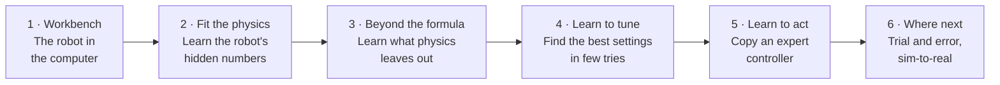
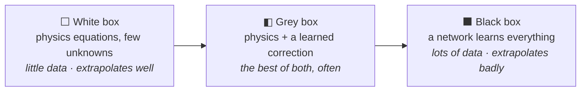
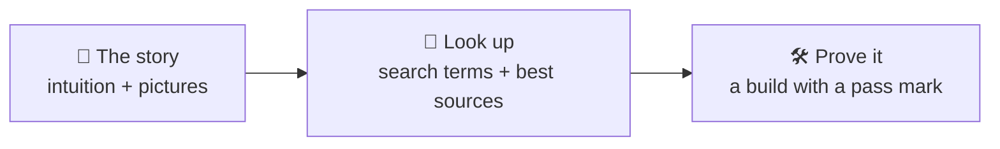
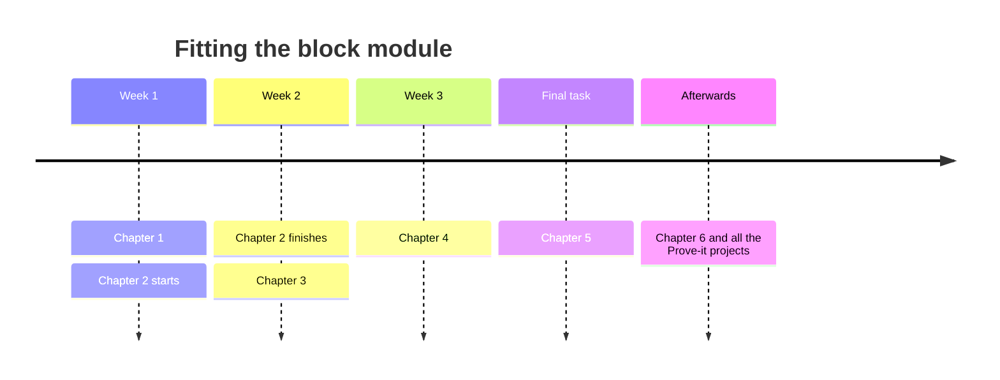
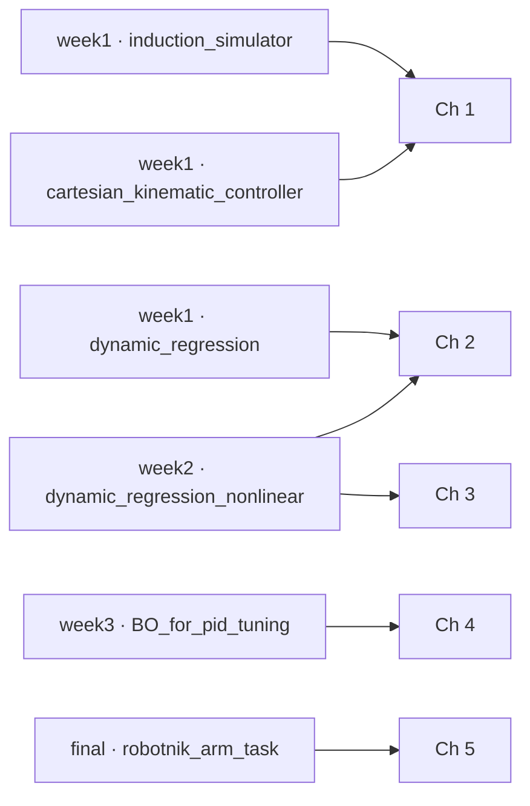

# The Learning Robot Story

Robots run on equations: physics tells you what torque moves an arm. But the equations
are never quite right. Masses are uncertain, friction is messy, the best controller
settings are unknown, and some behaviours are too complicated to write down at all.
*Machine Learning for Robotics* is about filling those gaps with data. This tutorial
tells that story in six chapters, each one learning something harder than the last.

| Chapter | The question it answers | Labs |
|---|---|---|
| [1 · Workbench](1-workbench.md) | How do we simulate and control a robot from Python? | Week 1 |
| [2 · Fit the physics](2-fit-the-physics.md) | Can data reveal the robot's masses and inertias? | Weeks 1–2 |
| [3 · Beyond the formula](3-beyond-the-formula.md) | What if the physics formula itself is incomplete? | Week 2 |
| [4 · Learn to tune](4-learn-to-tune.md) | How do we find good controller gains when every test is expensive? | Week 3 |
| [5 · Learn to act](5-learn-to-act.md) | Can a network learn to drive and reach like an expert? | Final task |
| [6 · Where next](6-where-next.md) | Learning by trial and error, and crossing from simulation to reality | — |

## One idea ties it together

Every model you build sits somewhere on a line from "all physics" to "all data":

Chapter 2 lives at the white end, Chapter 3 moves to grey, and Chapters 5–6 go black.
Knowing *where* to sit for a given problem is the real skill.

## How each lesson works

Lessons give you the *shape* of an idea, not the full detail. **Look up** lists what to
search for and where to read. **Prove it** is a project that only counts as passed when a
number says so.

## Pace

## Where the labs fit

## Ground rules

* **Integrity.** The labs and the final task are assessed. This tutorial explains the
  ideas behind every TODO but never fills them in, and Chapter 5 deliberately doesn't
  prescribe a model for the final task. Do the "Prove it" projects in your own
  workspace, *after* the related lab, and check course policy before publishing.
* **Tools.** Everything runs in the course's
  [RoboEnv](https://github.com/VModugno/RoboEnv) environment (pixi), using
  pybullet for physics and Pinocchio for the robot model.
* **Method.** Plot the data before fitting it → fit something simple → test on data the
  model never saw → only then reach for something fancier.

## The bookshelf

* **Bishop, *Pattern Recognition and Machine Learning*** (free from Microsoft
  Research): regression, kernels, probabilistic thinking.
* **James et al., *An Introduction to Statistical Learning*** (free at
  [statlearning.com](https://www.statlearning.com/)): the friendliest route to
  regression, trees and model checking.
* **Rasmussen & Williams, *Gaussian Processes for Machine Learning*** (free at
  [gaussianprocess.org/gpml](https://gaussianprocess.org/gpml/)).
* **Lynch & Park, *Modern Robotics*** (free, with videos), for the robot physics:
  [hades.mech.northwestern.edu](https://hades.mech.northwestern.edu/index.php/Modern_Robotics).

Start here → [Chapter 1 · Workbench](1-workbench.md)
